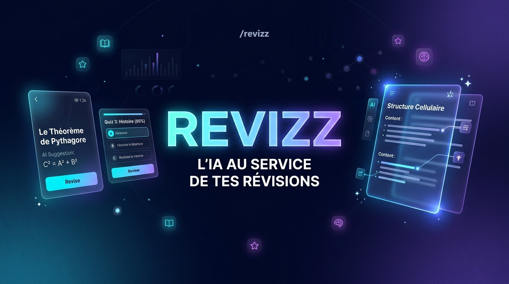
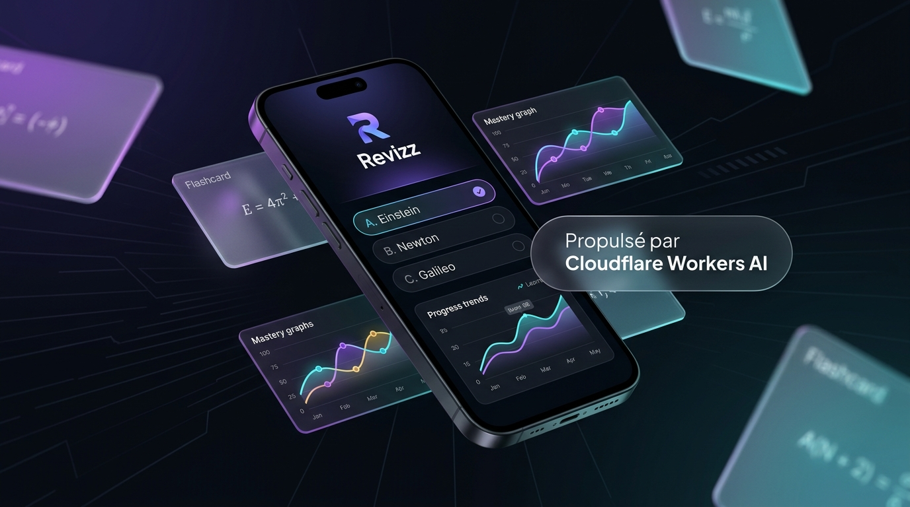
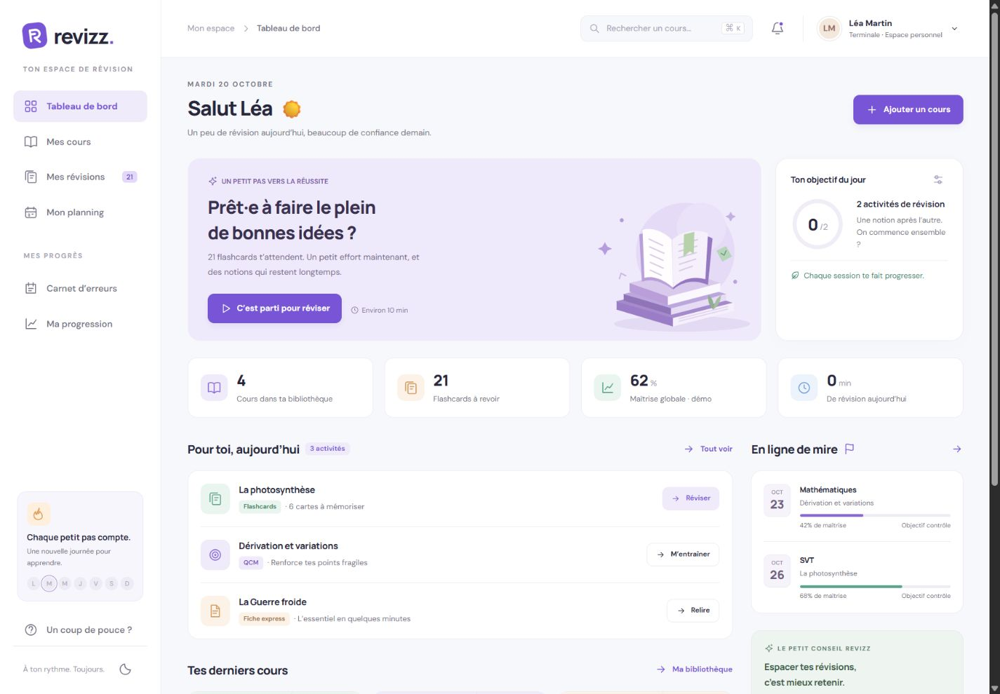
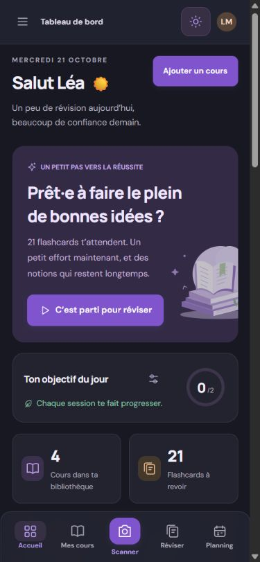
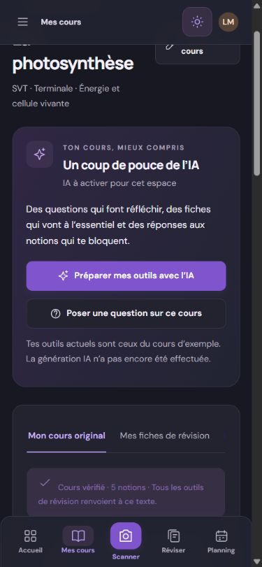
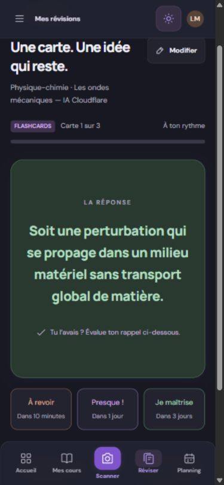
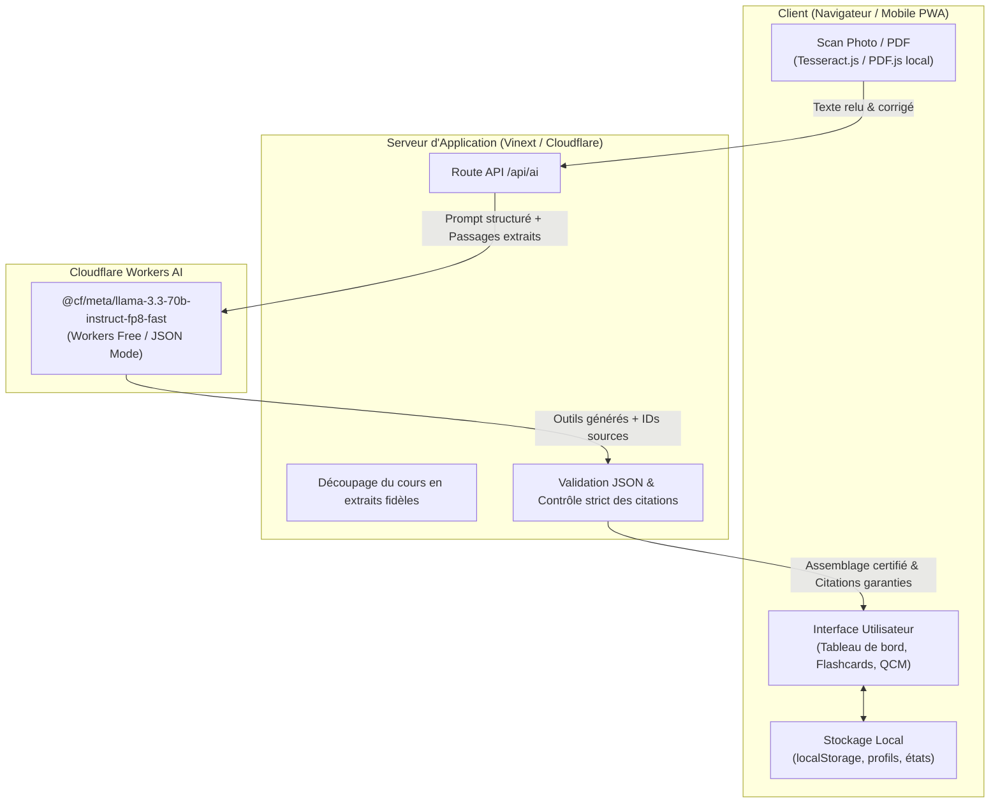

<div align="center">



# 🎓 Revizz

**Tes cours deviennent tes meilleurs outils de révision.**

[](https://github.com/ZEBDA1/revizz/actions/workflows/ci.yml)
[](https://nodejs.org/)
[](https://www.typescriptlang.org/)
[](https://developers.cloudflare.com/workers-ai/)
[](LICENSE)
[](#-démarrage-rapide)

<br/>

[⚡ **Démarrage Rapide**](#-démarrage-rapide) &nbsp;•&nbsp; [✨ **Fonctionnalités**](#-fonctionnalités-clés) &nbsp;•&nbsp; [🏗️ **Architecture**](#️-architecture--flux-technique) &nbsp;•&nbsp; [📖 **Guide de Déploiement**](docs/DEPLOIEMENT.md)

---

</div>

<br/>

<div align="center">
  
</div>

<br/>

## ✨ À propos de Revizz

**Revizz** est une application web moderne (mobile, tablette et ordinateur) conçue pour transformer n'importe quel cours (manuscrit, polycopié, livre, PDF) en un ensemble complet et personnalisé d'outils de révision interactifs.

Grâce à une chaîne de traitement robuste combinant un OCR local respectueux de la vie privée et la puissance de **Cloudflare Workers AI** (`@cf/meta/llama-3.3-70b-instruct-fp8-fast`), Revizz génère instantanément :
- 🗂️ **Des flashcards actives** avec répétition espacée et auto-évaluation.
- 📑 **Trois fiches de synthèse complémentaires** exportables en PDF.
- 🎯 **Des QCM interactifs** avec distracteurs crédibles et justifications détaillées.
- ✍️ **Des entraînements rédigés** avec repérage des notions clés.
- 💡 **Un assistant pédagogique sourcé** capable de répondre aux questions en s'appuyant rigoureusement sur le texte source.

---

## 🌟 Fonctionnalités Clés

| Fonctionnalité | Description |
| :--- | :--- |
| 📸 **Scan & Transcription OCR** | Capture photo ou import PDF. Reconnaissance de caractères locale via Tesseract.js / PDF.js avec écran de relecture et correction immédiate. |
| 🧠 **Génération IA Fiable** | Modèle Llama 3.3 70B Instruct via Cloudflare Workers AI. Formatage JSON strict validé côté serveur avec contrôle complet de la structure. |
| 🔍 **Citations Sources Certifiées** | Découpage du cours en passages numérotés. L'IA référence les passages et le serveur injecte la citation textuelle exacte : **aucune invention de source ni hallucination possible**. |
| 💬 **Méthode « Page Blanche »** | L'utilisateur explique le cours avec ses propres mots ; l'IA analyse le sens, valide les notions acquises, pointe les lacunes et propose des relances ciblées sans notation punitive. |
| 🌙 **Design Sombre & Responsive** | Interface soignée avec thème clair / sombre, fluidité mobile tactile et raccourcis desktop. |
| 📊 **Maîtrise & Répétition Espacée** | Suivi en temps réel de l'état de rétention (À revoir, Presque, Je maîtrise) et algorithme d'espacement des révisions. |
| 📴 **Mode Local Sans IA** | Fonctionne même sans connexion ou sans quota IA : mode d'extraction de phrases locales et cours de démonstration intégrés. |

---

## 📱 Aperçu de l'Interface

<div align="center">

### Tableau de bord complet (Desktop)


### Expérience Mobile & PWA
<table align="center" style="border: none;">
  <tr>
    <td align="center" width="33%">
      <b>Mode Sombre & Planning</b><br/><br/>
      
    </td>
    <td align="center" width="33%">
      <b>Génération IA & Citations</b><br/><br/>
      
    </td>
    <td align="center" width="33%">
      <b>Flashcards & Espacement</b><br/><br/>
      
    </td>
  </tr>
</table>

</div>

---

## 🏗️ Architecture & Flux Technique



---

## 🚀 Démarrage Rapide

### Prérequis
- **Node.js 24+** (indiqué dans le fichier `.nvmrc`)
- **Git**

### Installation et exécution

```bash
# Cloner le dépôt
git clone https://github.com/ZEBDA1/revizz.git
cd revizz

# Installer les dépendances propres
npm ci

# Lancer la suite de vérifications et tests
npm run check

# Compiler l'application
npm run build

# Démarrer le serveur de développement
npm run dev
```

L'application démarre et affiche son adresse dans le terminal (par exemple `http://127.0.0.1:4173`).

---

## 🔑 Configuration de Cloudflare Workers AI

Pour activer la génération IA lors du développement local :

1. Copiez le gabarit d'environnement :
   ```bash
   cp .env.example .env.local
   ```
2. Rendez-vous sur votre tableau de bord **Cloudflare** → **Workers AI** → **Use REST API** → **Create a Workers AI API Token**.
3. Renseignez vos identifiants dans `.env.local` (automatiquement ignoré par Git) :
   ```ini
   CLOUDFLARE_ACCOUNT_ID=votre_account_id_ici
   CLOUDFLARE_API_TOKEN=votre_api_token_ici
   ```
4. Testez la connexion en direct avec votre quota gratuit (10 000 neurons offerts quotidiennement) :
   ```bash
   node --env-file=.env.local check-cloudflare-live.mjs
   ```

---

## 🧪 Tests & Sécurité

Le projet intègre un protocole de vérification rigoureux exécuté automatiquement à chaque push via GitHub Actions :

```bash
# Exécute les 16 tests unitaires de transport et validation IA,
# la vérification stricte des types TypeScript et l'audit anti-fuite de secrets
npm run check

# Audit des secrets et fichiers suivis uniquement
npm run check:secrets
```

---

## 🛡️ Respect de la Vie Privée & Données

- **Traitement OCR en local** : La reconnaissance d'écriture s'effectue directement sur votre appareil via WebAssembly. Aucune image ni photo n'est transmise à l'IA.
- **Stockage sur l'appareil** : L'ensemble des fiches, cours, profils et notes reste dans votre `localStorage` local.
- **Aucune fuite de clé** : Le frontend n'a jamais accès aux identifiants Cloudflare, qui restent confinés au serveur applicatif.

---

## 📄 Licence

Ce projet est sous licence [MIT](LICENSE) — Développé avec passion par [ZEBDA](https://github.com/ZEBDA1).
